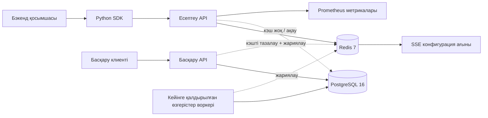
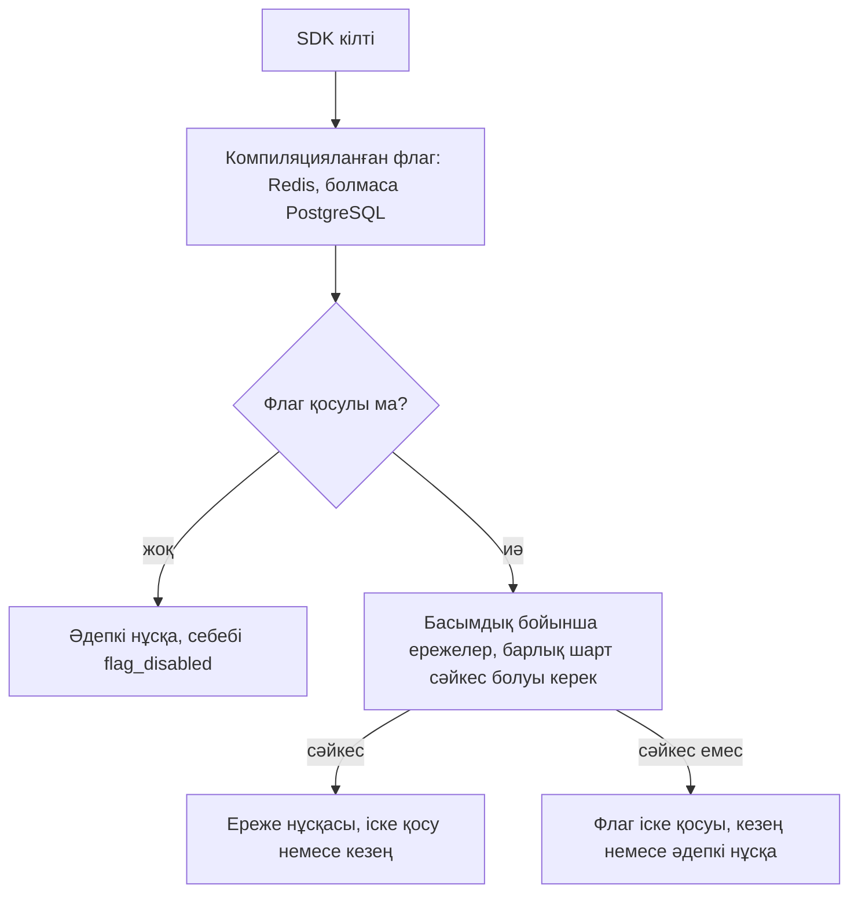

<div align="center">

# CohortSwitch

**Бэкенд командаларына арналған, өз серверіңізде жұмыс істейтін фича-флагтар мен біртіндеп іске қосу.**

Функцияны флаг артына жасырып, пайдаланушылардың 5%-ына қосыңыз, метрикаларды бақылаңыз, 100%-ға жеткізіңіз немесе бір сұраныспен өшіріңіз.


[English](README.md) · [Русский](README.ru.md) · **Қазақша**

</div>

## Бұл не

CohortSwitch — өзіңіз іске қосатын фича-флаг сервисі. Жазу PostgreSQL-ге нұсқа суретімен және аудит оқиғасымен бірге бір транзакцияда түседі. Оқу Redis-тен беріледі, Redis қолжетімсіз болса PostgreSQL-ден, сондықтан кэш ақауы флагтарды ешқашан өшірмейді. Есептеу қозғалтқышы енгізу-шығарусыз таза Python-да жазылған, сондықтан әр шешім қайталанады және тестпен оңай тексеріледі.

| | |
|---|---|
| **Таргетинг** | Кез келген атрибут бойынша ЖӘНЕ шарттары бар реттелген ережелер: теңдік, тізімдер, префикстер, сандар, семантикалық нұсқалар |
| **Іске қосу** | 0,01% дәлдікпен пайыздық іске қосу, пайдаланушыға бекітілген, уақыт бойынша кезеңдік іске қосу |
| **Қауіпсіздік** | Апаттық сөндіргіш кез келген ережеден бұрын тексеріледі, әр жазуда оптимистік құлыптау, кез келген нұсқаға қайтару |
| **Жоспарлау** | Белгіленген уақытта қосу, өшіру, нұсқаны немесе іске қосу пайызын өзгерту |
| **Жеткізу** | REST API, топтық есептеу, ETag бар конфигурация суреттері, SSE арқылы жаңартулар, асинхронды Python SDK |
| **Пайдалану** | Prometheus метрикалары, сұраныс ID-і бар құрылымды логтар, Redis жоғалуын деградация деп хабарлайтын readiness |
| **Қолжетімділік** | Ұйымдар, жобалар, орталар, рөлдер; SDK және management кілттері хэш түрінде сақталады және аймақпен шектеледі |

## Архитектура



PostgreSQL — шындық көзі. Флаг жазбасы, өзгермейтін нұсқа суреті, орта ревизиясы және аудит оқиғасы бірге бекітіледі. Redis-те қысқа өмірлі компиляцияланған конфигурациялар, лимит есептегіштері және Pub/Sub таралымы сақталады, бірақ шешуші сөз оған тиесілі емес. Толығырақ [docs/ARCHITECTURE.md](docs/ARCHITECTURE.md) ішінде.

## Флаг қалай есептеледі



Әр нәтижеде себеп (`flag_disabled`, `targeting_match`, `percentage_rollout`, `progressive_rollout`, `default`), сәйкес келген ереже және конфигурация нұсқасы бар, сондықтан «бұл пайдаланушы неге осы мәнді алды» деген сұраққа әрқашан жауап бар. Толығырақ [docs/EVALUATION.md](docs/EVALUATION.md) ішінде.

### Бекітілген іске қосу

Себет — аттар кеңістігінен, жобадан, ортадан, флаг кілтінен, субъект кілтінен және флаг тұзынан алынған BLAKE2b хэші, `0..9999` аралығына келтірілген. Шекаралар жинақталады, сондықтан 5%-ға кірген пайдаланушылар іске қосу 10% пен 20%-ға өскенде де ішінде қалады. Бір пайдаланушы кез келген серверде және кез келген қайта іске қосудан кейін бірдей жауап алады.

### Операторлар

`equals`, `not_equals`, `in`, `not_in`, `contains`, `starts_with`, `ends_with`, `exists`, `not_exists`, `greater_than`, `greater_or_equal`, `less_than`, `less_or_equal`, `semver_equal`, `semver_greater`, `semver_less`. Ереже барлық шарты сәйкес келгенде іске асады; бірінші сәйкес келген ереже жеңеді. `in` және `not_in` тізім қабылдайды: `{"attribute": "country", "operator": "in", "value": ["KZ", "UZ"]}`.

## Осы нұсқада не жаңа

| Не | Қазір қалай жұмыс істейді |
|---|---|
| Кейінге қалдырылған өзгерістер оқшауланған | Әр өзгеріс өз сақтау нүктесінде қолданылады. Енді қолдануға болмайтын өзгеріс себебімен бірге `failed_at` деп белгіленеді, топтағы қалғандары өтеді. |
| Кейінге қалдырылған өзгерістер бірден тексеріледі | Деректер құру кезінде тексеріледі: іске қосуға 0-ден 10000-ға дейінгі пайыз және екі нұсқа керек, `activate_at` уақыт белдеуімен болуы керек, барлық нұсқа флагта болуы тиіс. |
| Кейінге қалдырылған өзгерістер тарихы | `GET /api/v1/flags/{flag_id}/scheduled-changes` күтудегі, қолданылған және сәтсіз өзгерістерді қате мәтінімен көрсетеді. |
| Тізімге тиесілілік | `in` және `not_in` мәндер тізімімен салыстырады. Жол енді ішкі жол бойынша сәйкес келмейді, сондықтан `"us"` мәні `"russia"` ішіне кірмейді. |
| Миграция | `0002` `scheduled_changes` кестесіне `failed_at` және `last_error` қосады. |

## Жылдам бастау

Compose бар Docker керек.

```bash
cp .env.example .env      # COHORTSWITCH_JWT_SECRET мәнін орнатыңыз
docker compose up --build
curl http://localhost:8000/health/ready
```

Compose PostgreSQL-ді күтеді, миграцияларды қолданады және API мен жоспарлағышты іске қосады. OpenAPI `/docs` мекенжайында.

Python 3.12-де жергілікті әзірлеу:

```bash
python -m venv .venv
python -m pip install -e ".[dev]" -e sdk/python
alembic -c backend/alembic.ini upgrade head
uvicorn backend.app.main:app --reload
python -m backend.app.scheduler       # кейінге қалдырылған өзгерістер воркері
```

## Python SDK

```python
from cohortswitch import CohortSwitchClient

async with CohortSwitchClient(
    base_url="http://localhost:8000",
    sdk_key="cs_sdk_live_...",
    cache_ttl_seconds=2,
) as client:
    enabled = await client.is_enabled(
        "new_checkout",
        subject_key="user_42",
        attributes={"country": "KZ", "plan": "PRO"},
    )
```

`evaluate()` типтелген нәтиже қайтарады, `is_enabled()` логикалық мәнді талап етеді, `get_value()` кез келген нұсқаны қайтарады, ал `evaluate_batch()` бір сұраныста 100 флагқа дейін өңдейді. Уақыт асуы, желі және API қателері `CohortSwitchError` болады.

## API мысалдары

5% іске қосуы бар флаг жасау:

```http
POST /api/v1/projects/{project_id}/flags
Authorization: Bearer {access_token}

{
  "environment_id": "…",
  "key": "new_checkout",
  "name": "New checkout",
  "flag_type": "BOOLEAN",
  "enabled": true,
  "default_variation": "disabled",
  "variations": [
    {"key": "enabled", "value": true},
    {"key": "disabled", "value": false}
  ],
  "rollout": [
    {"variation": "enabled", "percentage_basis_points": 500},
    {"variation": "disabled", "percentage_basis_points": 9500}
  ]
}
```

Ертең UTC бойынша 09:00-де 25%-ға көтеру:

```http
POST /api/v1/flags/{flag_id}/scheduled-changes
Authorization: Bearer {access_token}

{
  "environment_id": "…",
  "expected_version": 1,
  "change_type": "rollout_percentage",
  "activate_at": "2026-11-17T09:00:00Z",
  "payload": {"percentage_basis_points": 2500, "variation": "enabled", "fallback_variation": "disabled"}
}
```

`POST /api/v1/sdk-keys` бір рет беретін SDK кілтімен есептеу:

```http
POST /api/v1/evaluate
X-CohortSwitch-Key: cs_sdk_live_...

{"flag_key": "new_checkout", "subject_key": "user_42", "attributes": {"country": "KZ"}}
```

## Нұсқалар және қайшылықтар

Жазу `expected_version` жібереді. Жаңарту `UPDATE … WHERE current_version = expected_version` ретінде орындалады, ескірген жазушы ағымдағы нұсқамен бірге `409 configuration_conflict` алады. Қайтару ескі суретті жаңа нұсқаға көшіреді: v17-ні v12-ге қайтару v18 жасайды, тарих ешқашан қайта жазылмайды.

## Бақылау

| Мекенжай | Не көрсетеді |
|---|---|
| `GET /health/live` | Процесс жұмыс істеп тұр |
| `GET /health/ready` | PostgreSQL қолжетімді; Redis жоғалуы деградация деп белгіленеді |
| `GET /metrics` | HTTP кідірісі мен саны, себептер бойынша шешімдер, кэш сәйкестігі мен жіберілуі |

Логтар JSON пішімінде: сұраныс ID-і, маршрут, күй және ұзақтық, тіркелгі деректері мен есептеу атрибуттарынсыз. Әр жауап `X-Request-ID` қайтарады, аудит оқиғалары оны сақтайды.

## Қауіпсіздік

Құпиясөздер Argon2-мен хэштеледі. Refresh-токендер мөлдір емес, әр қолданғанда ауысады және хэш түрінде сақталады; қайта пайдалану бүкіл топты жояды. SDK және management кілттері криптографиялық тұрақты генератормен жасалады, SHA-256 ретінде сақталады және бір рет көрсетіледі. Тенант тексерісі кез келген деректі ашпас бұрын жүреді, рұқсаттар бір жерде жиналған, SDK кілттері басқару API-ын шақыра алмайды. [docs/SECURITY.md](docs/SECURITY.md) қараңыз.

## Тесттер

```bash
ruff check . && ruff format --check .
pytest -m "not integration"          # 52 тест, сервистер керек емес
pytest                               # PostgreSQL мен Redis-те тағы 4 интеграциялық тест
python -m build sdk/python
```

Модульдік тесттер операторларды, ережелер ретін, қатаң флаг типтерін, іске қосу кезеңдерін, апаттық сөндіргіш басымдығын, процестер арасындағы хэш тұрақтылығын, іске қосудың монотонды өсуін және 10 000 субъектідегі таралуды тексереді. Smoke-тесттер жадтағы SQLite-та бүкіл HTTP жолынан өтеді, кейінге қалдырылған өзгерістерді қоса. Интеграциялық тесттер нақты PostgreSQL және Redis-пен жұмыс істейді: қайшылықтар, қайтару, кэш ақауындағы резерв, ETag, аудит, кілт шекаралары, SSE және SDK. CI барлығын іске қосады.

## Құрылым

```text
backend/app/
├── api/          HTTP маршруттары, авторизация тәуелділіктері, схемалар
├── core/         баптаулар, қауіпсіздік, middleware, рұқсаттар, метрикалар, Redis
├── database/     SQLAlchemy 2 модельдері және асинхронды сессиялар
├── evaluation/   таза операторлар, модельдер, хэштеу және шешім қозғалтқышы
├── scheduler/    кейінге қалдырылған өзгерістер воркері
└── services/     транзакциялар, компиляция, кэш, кілттер, аудит
backend/alembic/  миграциялар
backend/tests/    модульдік, smoke және интеграциялық тесттер
sdk/python/       асинхронды SDK, бөлек жиналады
docs/             архитектура, есептеу, қауіпсіздік, сенімділік
```

## Ымыралар

- Кэшті тазалау қысқа TTL-мен «бекіту, сосын жою» тәсілімен жасалады, транзакциялық outbox арқылы емес. Процесс бекітуден кейін бірден құласа, ескіру TTL-мен шектеледі.
- Іске қосу кезеңдері сұраныс сәтінде сағат бойынша есептеледі, сондықтан жоспарлы өсуге воркер керек емес. Нақты кейінге қалдырылған өзгерістерді жолдарды құлыптайтын PostgreSQL сұрау воркері қолданады.
- Сұраныс лимиттері Redis-те есептеледі, ал ол істен шыққанда процесс ішіндегі қосалқы есептегіш жұмыс істейді: қолжетімділік маңыздырақ, жаһандық лимиттер уақытша жуықтап есептеледі.
- SSE жеткізуге кепілдік бермейді. Үзілістен кейін клиент орта ревизиясы мен ETag суреті бойынша қалпына келеді.
- Метрикаларда субъект кілттері мен атрибуттар жоқ; нұсқа мен себеп белгілері конфигурациямен шектелген.

## Жоспарлар

- Қол қойылған офлайн конфигурация пакеттері
- Жеке деректерсіз іріктеумен эксперимент көрсетілімдерін экспорттау
- Продакшендегі өзгерістерді келісу
- Жаңа серверлік SDK-лар

## Автор

Koncha Artyom, [github.com/artyom129](https://github.com/artyom129). Бэкенд және инфрақұрылым бойынша фрилансқа ашықпын.

## Лицензия

[MIT](LICENSE)
