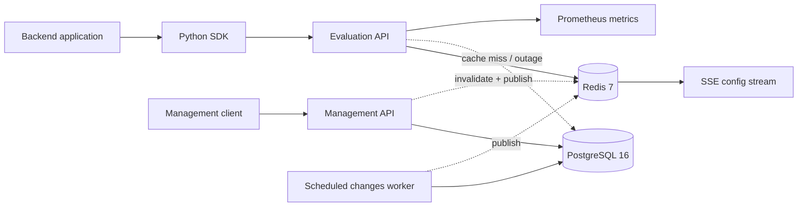
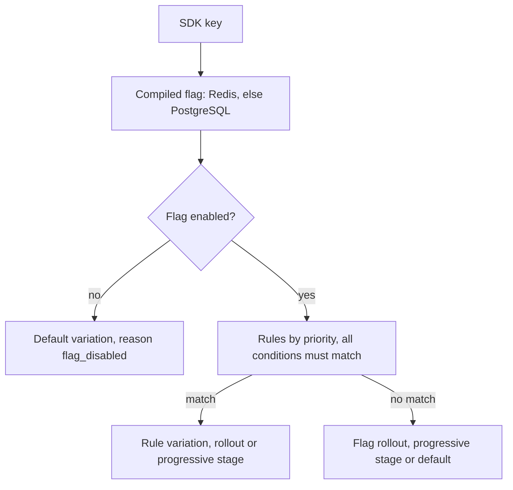

<div align="center">

# CohortSwitch

**Self-hosted feature flags and progressive rollouts for backend teams.**

Ship behind a flag, roll out to 5% of users, watch the metrics, go to 100% or kill it in one call.


**English** · [Русский](README.ru.md) · [Қазақша](README.kk.md)

</div>

## What it is

CohortSwitch is a feature flag service you run yourself. Writes go to PostgreSQL in one transaction with a version snapshot and an audit event. Reads are served from Redis and fall back to PostgreSQL when Redis is down, so a cache outage never turns flags off. The evaluation engine is pure Python with no I/O, which makes every decision reproducible and easy to test.

| | |
|---|---|
| **Targeting** | Ordered rules with AND conditions on any attribute: equality, lists, prefixes, numbers, semantic versions |
| **Rollouts** | Percentage rollouts with 0.01% precision, sticky per user, and time-based progressive stages |
| **Safety** | Kill switch checked before any rule, optimistic locking on every write, rollback to any version |
| **Scheduling** | Enable, disable, change the variation or the rollout percentage at a set time |
| **Delivery** | REST API, batch evaluation, ETag config snapshots, live updates over SSE, async Python SDK |
| **Operations** | Prometheus metrics, structured logs with request IDs, readiness that reports Redis loss as degraded |
| **Access** | Organizations, projects, environments, roles; SDK and management keys hashed at rest and scoped |

## Architecture



PostgreSQL is the source of truth. A flag write, its immutable version snapshot, the environment revision and the audit event commit together. Redis holds short-lived compiled configurations, rate-limit counters and Pub/Sub fan-out, and is never authoritative. More in [docs/ARCHITECTURE.md](docs/ARCHITECTURE.md).

## How a flag is evaluated



Every result carries the reason (`flag_disabled`, `targeting_match`, `percentage_rollout`, `progressive_rollout`, `default`), the matched rule and the config version, so you can always answer "why did this user get this value". Details in [docs/EVALUATION.md](docs/EVALUATION.md).

### Sticky rollouts

The bucket is a BLAKE2b hash of the namespace, project, environment, flag key, subject key and a per-flag salt, mapped to `0..9999`. Boundaries are cumulative, so users inside 5% stay inside when the rollout grows to 10% and 20%. The same user gets the same answer on every server and after every restart.

### Operators

`equals`, `not_equals`, `in`, `not_in`, `contains`, `starts_with`, `ends_with`, `exists`, `not_exists`, `greater_than`, `greater_or_equal`, `less_than`, `less_or_equal`, `semver_equal`, `semver_greater`, `semver_less`. A rule matches when all its conditions match; the first matching rule wins. `in` and `not_in` take a list: `{"attribute": "country", "operator": "in", "value": ["KZ", "UZ"]}`.

## What is new in this version

| What | How it works now |
|---|---|
| Scheduled changes are isolated | Each due change is applied in its own savepoint. A change that can no longer be applied is marked `failed_at` with the reason, and the rest of the batch goes through. |
| Scheduled changes are checked up front | The payload is validated when the change is created: a rollout needs a percentage from 0 to 10000 and both variations, `activate_at` must carry a time zone, and every variation must exist on the flag. |
| Scheduled change history | `GET /api/v1/flags/{flag_id}/scheduled-changes` lists pending, applied and failed changes with the error text. |
| List membership | `in` and `not_in` compare against a list of values. A string value no longer matches by substring, so `"us"` is not "in" `"russia"`. |
| Migration | `0002` adds `failed_at` and `last_error` to `scheduled_changes`. |

## Quick start

Requirements: Docker with Compose.

```bash
cp .env.example .env      # set COHORTSWITCH_JWT_SECRET
docker compose up --build
curl http://localhost:8000/health/ready
```

Compose waits for PostgreSQL, applies migrations and starts the API and the scheduler. OpenAPI is at `/docs`.

Local development on Python 3.12:

```bash
python -m venv .venv
python -m pip install -e ".[dev]" -e sdk/python
alembic -c backend/alembic.ini upgrade head
uvicorn backend.app.main:app --reload
python -m backend.app.scheduler       # scheduled changes worker
```

## Python SDK

```python
from cohortswitch import CohortSwitchClient

async with CohortSwitchClient(
    base_url="http://localhost:8000",
    sdk_key="cs_sdk_live_...",
    cache_ttl_seconds=2,
) as client:
    enabled = await client.is_enabled(
        "new_checkout",
        subject_key="user_42",
        attributes={"country": "KZ", "plan": "PRO"},
    )
```

`evaluate()` returns a typed result, `is_enabled()` insists on a boolean, `get_value()` returns any variation and `evaluate_batch()` handles up to 100 flags per call. Timeouts, network and API errors become `CohortSwitchError`.

## API examples

Create a flag with a 5% rollout:

```http
POST /api/v1/projects/{project_id}/flags
Authorization: Bearer {access_token}

{
  "environment_id": "…",
  "key": "new_checkout",
  "name": "New checkout",
  "flag_type": "BOOLEAN",
  "enabled": true,
  "default_variation": "disabled",
  "variations": [
    {"key": "enabled", "value": true},
    {"key": "disabled", "value": false}
  ],
  "rollout": [
    {"variation": "enabled", "percentage_basis_points": 500},
    {"variation": "disabled", "percentage_basis_points": 9500}
  ]
}
```

Raise it to 25% tomorrow at 09:00 UTC:

```http
POST /api/v1/flags/{flag_id}/scheduled-changes
Authorization: Bearer {access_token}

{
  "environment_id": "…",
  "expected_version": 1,
  "change_type": "rollout_percentage",
  "activate_at": "2026-11-17T09:00:00Z",
  "payload": {"percentage_basis_points": 2500, "variation": "enabled", "fallback_variation": "disabled"}
}
```

Evaluate it with the SDK key returned once by `POST /api/v1/sdk-keys`:

```http
POST /api/v1/evaluate
X-CohortSwitch-Key: cs_sdk_live_...

{"flag_key": "new_checkout", "subject_key": "user_42", "attributes": {"country": "KZ"}}
```

## Versions and conflicts

Writes send `expected_version`. The update is `UPDATE … WHERE current_version = expected_version`, and a stale writer gets `409 configuration_conflict` with the current version. Rollback copies an old snapshot into a new version: rolling v17 back to v12 creates v18, so history is never rewritten.

## Observability

| Endpoint | What it shows |
|---|---|
| `GET /health/live` | The process is up |
| `GET /health/ready` | PostgreSQL is reachable; Redis loss is reported as degraded |
| `GET /metrics` | HTTP latency and totals, evaluation decisions by reason, cache hits and misses |

Logs are JSON with request ID, route, status and duration, and never include credentials or evaluation attributes. Every response returns `X-Request-ID`, and audit events keep it.

## Security

Passwords use Argon2. Refresh tokens are opaque, rotate on use and are hashed at rest; reusing one revokes the whole family. SDK and management keys come from a secure RNG, are stored as SHA-256 hashes and are shown once. Tenant checks happen before anything is disclosed, permissions live in one place, and SDK keys cannot call management endpoints. See [docs/SECURITY.md](docs/SECURITY.md).

## Tests

```bash
ruff check . && ruff format --check .
pytest -m "not integration"          # 52 tests, no services needed
pytest                               # adds 4 integration tests on PostgreSQL and Redis
python -m build sdk/python
```

Unit tests cover operators, rule order, strict flag types, progressive stages, kill-switch priority, hash stability across processes, monotonic rollout growth and a 10,000-subject distribution check. Smoke tests run the full HTTP path on in-memory SQLite, including scheduled changes. Integration tests use real PostgreSQL and Redis for conflicts, rollback, cache fallback, ETag, audit, key boundaries, SSE and the SDK. CI runs all of them.

## Project layout

```text
backend/app/
├── api/          HTTP routes, auth dependencies, schemas
├── core/         settings, security, middleware, permissions, metrics, Redis
├── database/     SQLAlchemy 2 models and async sessions
├── evaluation/   pure operators, models, hashing and decision engine
├── scheduler/    scheduled changes worker
└── services/     transactions, compilation, cache, keys, audit
backend/alembic/  migrations
backend/tests/    unit, smoke and integration tests
sdk/python/       async SDK, built separately
docs/             architecture, evaluation, security, reliability
```

## Design trade-offs

- Cache invalidation is commit-then-delete with a short TTL rather than a transactional outbox. If the process dies right after commit, the stale window is bounded by the TTL.
- Progressive stages are resolved from the clock at evaluation time, so planned growth needs no worker. Explicit scheduled changes use a PostgreSQL-backed poller with row locks.
- Rate limits use Redis counters with a per-process fallback during a Redis outage: availability first, global limits approximate for a while.
- SSE is not durable. After a disconnect the client recovers from the environment revision and the ETag snapshot.
- Metrics never carry subject keys or attributes; variation and reason labels are bounded by configuration.

## Roadmap

- Signed offline configuration bundles
- Experiment exposure export with privacy-safe sampling
- Approval policies for production changes
- More server-side SDKs

## Author

Built by [Koncha Artyom](https://github.com/artyom129). Open to freelance backend and infrastructure work.

## License

[MIT](LICENSE)
