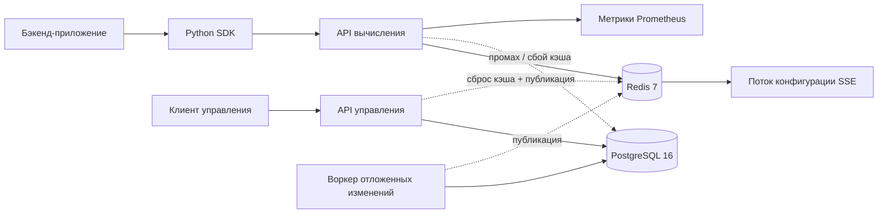
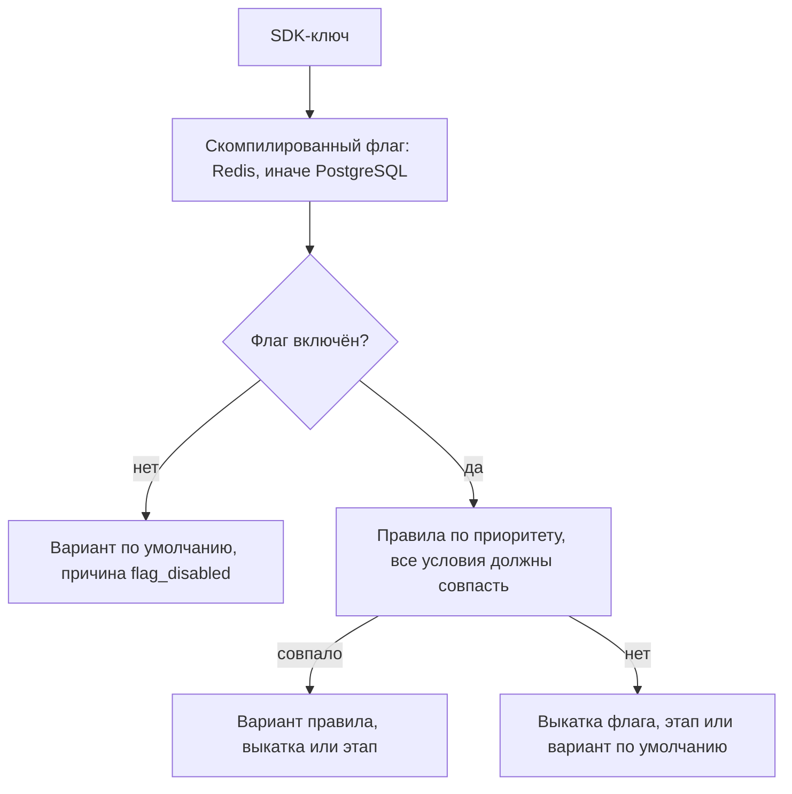

<div align="center">

# CohortSwitch

**Фича-флаги и постепенные выкатки на своём сервере для бэкенд-команд.**

Выкатите функцию за флагом на 5% пользователей, посмотрите на метрики, доведите до 100% или выключите одним запросом.


[English](README.md) · **Русский** · [Қазақша](README.kk.md)

</div>

## Что это

CohortSwitch — сервис фича-флагов, который вы запускаете у себя. Запись идёт в PostgreSQL одной транзакцией вместе со снимком версии и событием аудита. Чтение обслуживается из Redis, а если Redis недоступен, из PostgreSQL, поэтому сбой кэша никогда не выключает флаги. Движок вычисления написан на чистом Python без ввода-вывода, так что каждое решение воспроизводимо и легко проверяется тестами.

| | |
|---|---|
| **Таргетинг** | Правила по порядку с условиями через И по любому атрибуту: равенство, списки, префиксы, числа, семантические версии |
| **Выкатки** | Процентные выкатки с точностью 0,01%, закреплённые за пользователем, и поэтапные выкатки по времени |
| **Безопасность** | Аварийный выключатель срабатывает до любых правил, оптимистичная блокировка на каждой записи, откат к любой версии |
| **Планирование** | Включить, выключить, сменить вариант или процент выкатки в заданное время |
| **Доставка** | REST API, пакетное вычисление, снимки конфигурации с ETag, обновления через SSE, асинхронный Python SDK |
| **Эксплуатация** | Метрики Prometheus, структурные логи с ID запроса, readiness сообщает о потере Redis как о деградации |
| **Доступ** | Организации, проекты, окружения, роли; SDK- и management-ключи хранятся в виде хэшей и ограничены областью |

## Архитектура



PostgreSQL — источник истины. Запись флага, неизменяемый снимок версии, ревизия окружения и событие аудита фиксируются вместе. В Redis лежат короткоживущие скомпилированные конфигурации, счётчики лимитов и рассылка Pub/Sub, но решающего слова у него нет. Подробнее в [docs/ARCHITECTURE.md](docs/ARCHITECTURE.md).

## Как вычисляется флаг



Каждый результат содержит причину (`flag_disabled`, `targeting_match`, `percentage_rollout`, `progressive_rollout`, `default`), совпавшее правило и версию конфигурации, поэтому на вопрос «почему этот пользователь получил это значение» всегда есть ответ. Подробнее в [docs/EVALUATION.md](docs/EVALUATION.md).

### Закреплённые выкатки

Корзина — это хэш BLAKE2b от пространства имён, проекта, окружения, ключа флага, ключа субъекта и соли флага, приведённый к `0..9999`. Границы накопительные, поэтому пользователи, попавшие в 5%, остаются внутри, когда выкатка растёт до 10% и 20%. Один и тот же пользователь получает один и тот же ответ на любом сервере и после любого перезапуска.

### Операторы

`equals`, `not_equals`, `in`, `not_in`, `contains`, `starts_with`, `ends_with`, `exists`, `not_exists`, `greater_than`, `greater_or_equal`, `less_than`, `less_or_equal`, `semver_equal`, `semver_greater`, `semver_less`. Правило срабатывает, когда совпали все его условия; побеждает первое сработавшее. `in` и `not_in` принимают список: `{"attribute": "country", "operator": "in", "value": ["KZ", "UZ"]}`.

## Что нового в этой версии

| Что | Как теперь работает |
|---|---|
| Отложенные изменения изолированы | Каждое изменение применяется в своей точке сохранения. Изменение, которое больше нельзя применить, помечается `failed_at` с причиной, а остальные в пакете проходят. |
| Отложенные изменения проверяются сразу | Данные проверяются при создании: выкатке нужен процент от 0 до 10000 и оба варианта, у `activate_at` должен быть часовой пояс, все варианты должны существовать у флага. |
| История отложенных изменений | `GET /api/v1/flags/{flag_id}/scheduled-changes` показывает ожидающие, применённые и неудачные изменения с текстом ошибки. |
| Принадлежность списку | `in` и `not_in` сравнивают со списком значений. Строка больше не совпадает по подстроке, поэтому `"us"` не входит в `"russia"`. |
| Миграция | `0002` добавляет `failed_at` и `last_error` в `scheduled_changes`. |

## Быстрый старт

Нужен Docker с Compose.

```bash
cp .env.example .env      # задайте COHORTSWITCH_JWT_SECRET
docker compose up --build
curl http://localhost:8000/health/ready
```

Compose дожидается PostgreSQL, применяет миграции и запускает API и планировщик. OpenAPI доступен на `/docs`.

Локальная разработка на Python 3.12:

```bash
python -m venv .venv
python -m pip install -e ".[dev]" -e sdk/python
alembic -c backend/alembic.ini upgrade head
uvicorn backend.app.main:app --reload
python -m backend.app.scheduler       # воркер отложенных изменений
```

## Python SDK

```python
from cohortswitch import CohortSwitchClient

async with CohortSwitchClient(
    base_url="http://localhost:8000",
    sdk_key="cs_sdk_live_...",
    cache_ttl_seconds=2,
) as client:
    enabled = await client.is_enabled(
        "new_checkout",
        subject_key="user_42",
        attributes={"country": "KZ", "plan": "PRO"},
    )
```

`evaluate()` возвращает типизированный результат, `is_enabled()` требует логическое значение, `get_value()` возвращает любой вариант, а `evaluate_batch()` обрабатывает до 100 флагов за запрос. Таймауты, сетевые ошибки и ошибки API превращаются в `CohortSwitchError`.

## Примеры API

Создать флаг с выкаткой на 5%:

```http
POST /api/v1/projects/{project_id}/flags
Authorization: Bearer {access_token}

{
  "environment_id": "…",
  "key": "new_checkout",
  "name": "New checkout",
  "flag_type": "BOOLEAN",
  "enabled": true,
  "default_variation": "disabled",
  "variations": [
    {"key": "enabled", "value": true},
    {"key": "disabled", "value": false}
  ],
  "rollout": [
    {"variation": "enabled", "percentage_basis_points": 500},
    {"variation": "disabled", "percentage_basis_points": 9500}
  ]
}
```

Поднять до 25% завтра в 09:00 UTC:

```http
POST /api/v1/flags/{flag_id}/scheduled-changes
Authorization: Bearer {access_token}

{
  "environment_id": "…",
  "expected_version": 1,
  "change_type": "rollout_percentage",
  "activate_at": "2026-11-17T09:00:00Z",
  "payload": {"percentage_basis_points": 2500, "variation": "enabled", "fallback_variation": "disabled"}
}
```

Вычислить флаг с SDK-ключом, который один раз выдаёт `POST /api/v1/sdk-keys`:

```http
POST /api/v1/evaluate
X-CohortSwitch-Key: cs_sdk_live_...

{"flag_key": "new_checkout", "subject_key": "user_42", "attributes": {"country": "KZ"}}
```

## Версии и конфликты

Запись передаёт `expected_version`. Обновление выполняется как `UPDATE … WHERE current_version = expected_version`, и устаревший писатель получает `409 configuration_conflict` с текущей версией. Откат копирует старый снимок в новую версию: откат v17 к v12 создаёт v18, история никогда не переписывается.

## Наблюдаемость

| Адрес | Что показывает |
|---|---|
| `GET /health/live` | Процесс работает |
| `GET /health/ready` | PostgreSQL доступен; потеря Redis отмечается как деградация |
| `GET /metrics` | Задержки и число HTTP-запросов, решения по причинам, попадания и промахи кэша |

Логи в JSON с ID запроса, маршрутом, статусом и длительностью, без учётных данных и атрибутов вычисления. Каждый ответ возвращает `X-Request-ID`, события аудита его сохраняют.

## Безопасность

Пароли хэшируются Argon2. Refresh-токены непрозрачные, меняются при каждом использовании и хранятся в виде хэшей; повторное использование отзывает всё семейство. SDK- и management-ключи создаются криптостойким генератором, хранятся как SHA-256 и показываются один раз. Проверка арендатора идёт до раскрытия любых данных, права собраны в одном месте, SDK-ключи не могут вызывать API управления. См. [docs/SECURITY.md](docs/SECURITY.md).

## Тесты

```bash
ruff check . && ruff format --check .
pytest -m "not integration"          # 52 теста, сервисы не нужны
pytest                               # плюс 4 интеграционных теста на PostgreSQL и Redis
python -m build sdk/python
```

Модульные тесты покрывают операторы, порядок правил, строгие типы флагов, этапы выкатки, приоритет аварийного выключателя, стабильность хэша между процессами, монотонный рост выкатки и проверку распределения на 10 000 субъектах. Smoke-тесты проходят весь HTTP-путь на SQLite в памяти, включая отложенные изменения. Интеграционные тесты работают с настоящими PostgreSQL и Redis: конфликты, откат, резерв при сбое кэша, ETag, аудит, границы ключей, SSE и SDK. CI запускает всё.

## Структура

```text
backend/app/
├── api/          HTTP-маршруты, зависимости авторизации, схемы
├── core/         настройки, безопасность, middleware, права, метрики, Redis
├── database/     модели SQLAlchemy 2 и асинхронные сессии
├── evaluation/   чистые операторы, модели, хэширование и движок решений
├── scheduler/    воркер отложенных изменений
└── services/     транзакции, компиляция, кэш, ключи, аудит
backend/alembic/  миграции
backend/tests/    модульные, smoke и интеграционные тесты
sdk/python/       асинхронный SDK, собирается отдельно
docs/             архитектура, вычисление, безопасность, надёжность
```

## Компромиссы

- Сброс кэша устроен как «зафиксировать, затем удалить» с коротким TTL, а не через транзакционный outbox. Если процесс упадёт сразу после фиксации, устаревание ограничено TTL.
- Этапы выкатки вычисляются по часам в момент запроса, поэтому плановый рост не требует воркера. Явные отложенные изменения применяет опрашивающий воркер на PostgreSQL с блокировкой строк.
- Лимиты запросов считаются в Redis, а при его сбое работает запасной счётчик в процессе: доступность важнее, глобальные лимиты на время приблизительные.
- SSE не гарантирует доставку. После обрыва клиент восстанавливается по ревизии окружения и снимку с ETag.
- В метриках нет ключей субъектов и атрибутов; метки варианта и причины ограничены конфигурацией.

## Планы

- Подписанные офлайн-пакеты конфигурации
- Выгрузка показов экспериментов с выборкой без персональных данных
- Согласование изменений в продакшене
- Новые серверные SDK

## Автор

Koncha Artyom, [github.com/artyom129](https://github.com/artyom129). Беру фриланс по бэкенду и инфраструктуре.

## Лицензия

[MIT](LICENSE)
